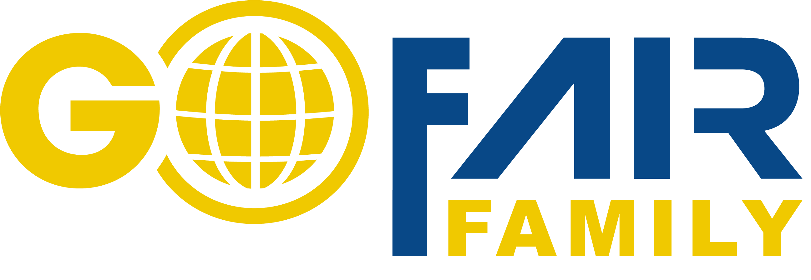

--------------------------------------------------------------------
{width="50%"}
-------------------------------------------------------------------

Dear Fellows and Friends!

The GFF Family Open House (hybrid) event is starting at 11:00 AM CET and featuring two focus sessions:

##### **Morning Session (11:00 – 13:00): Tailored specifically for online participants.**
&emsp;11:00 - 11:15 Introduction round\
&emsp;11:15 - 11:35 Barbara: Past achievements & planned activities\
&emsp;11:35 - 12:15 Presentations by attendees\
&emsp;12:15 - 12:30 Open Discussion\
&emsp;12:30 - 13:00 Qualifications\

##### **Afternoon Session (14:00 – 17:00): Tailored for both onsite and online attendees**
&emsp;14:00 - 14:15 Introduction round\
&emsp;14:15 - 14:30 Bert: Welcome from GO FAIR Foundation\
&emsp;14:30 - 14:45 Barbara: Past achievements\
&emsp;14:45 - 15:30 Presentations by attendees\
&emsp;15:30 - 16:00 Break\
&emsp;16:00 - 16:15 Barbara: Planned activities\
&emsp;16:15 - 16:30 Open Discussion\
&emsp;16:30 - 17:00 Qualifications\

We are also looking for people who are willing to present something, either in the morning or afternoon.\
If you are interested you can add you name and topic in this [google doc](https://docs.google.com/document/d/1tLe3SCdk8dWbsMMfSOXAax0hpc7okW6HZXnpWsfNzBk/edit?usp=sharing).
